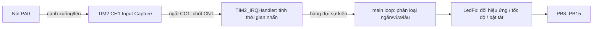

# BTL – Đo thời gian nhấn nút bằng Timer Input Capture, điều khiển hiệu ứng LED

**MCU:** STM32F103C8T6 (Blue Pill) · **Clock:** HSI 8 MHz · **Ngôn ngữ:** C (HAL + thanh ghi CMSIS)

> 📦 Hướng dẫn clone / cài đặt / build sau khi pull code: xem [SETUP.md](SETUP.md).

## 1. Chức năng

| Thao tác | Thời gian nhấn | Tác dụng |
|---|---|---|
| Nhấn nhấp | < 1 s | Đổi kiểu hiệu ứng LED (xoay vòng 7 hiệu ứng) |
| Nhấn giữ vừa | 1 s – 3 s | Đổi tốc độ: nhanh dần đến mức nhanh nhất rồi chậm dần (5 mức: 800/500/300/150/70 ms) |
| Nhấn giữ lâu | > 3 s | Bật/tắt toàn bộ hệ thống (Standby). Bật lại sẽ reset về mặc định |

Các hiệu ứng: Nháy đồng loạt → Chạy đuổi → Sáng dồn → Sáng/tắt dần → Knight Rider → Xen kẽ → Giữa ra ngoài.

**LED PC13 (có sẵn trên board) báo hiệu:**
- Đang giữ nút ≥ 1 s: sáng liên tục → nhả ra sẽ là "giữ vừa"
- Đang giữ nút > 3 s: nháy nhanh → nhả ra sẽ là "giữ lâu"
- Hệ thống Standby: chớp ngắn mỗi 2 s
- Nhấn < 50 ms bị coi là rung phím và bỏ qua.

## 2. Sơ đồ nối dây

| Linh kiện | Chân STM32 | Ghi chú |
|---|---|---|
| Nút nhấn | PA0 (TIM2_CH1) ↔ GND | Dùng pull-up nội, không cần điện trở ngoài. Nên mắc thêm tụ 100 nF song song nút |
| LED0 … LED7 | PB8 … PB15 | Mỗi LED nối tiếp R 220–330 Ω xuống GND (mức 1 = sáng) |
| LED trạng thái | PC13 | LED có sẵn trên Blue Pill |

> Nếu mắc LED kiểu anode chung (mức 0 = sáng) thì đặt `LED_ACTIVE_LOW = 1u` trong `led_effects.h`.

## 3. Cấu trúc code

| File | Vai trò |
|---|---|
| `Core/Src/button_ic.c`, `Core/Inc/button_ic.h` | TIM2 Input Capture: đo thời gian nhấn, chống rung, phân loại sự kiện |
| `Core/Src/led_effects.c`, `Core/Inc/led_effects.h` | 7 hiệu ứng, 5 mức tốc độ, bật/tắt hệ thống, LED trạng thái |
| `Core/Src/main.c` | Vòng lặp chính: lấy sự kiện nút → điều khiển LED (chỉ sửa trong vùng `USER CODE`) |

## 4. Nguyên lý Input Capture

1. TIM2 đếm ở **10 kHz** (1 tick = 0,1 ms), `PSC` được tính tự động theo clock APB1 nên vẫn đúng nếu đổi lên 72 MHz. `ARR = 0xFFFF`.
2. Ngắt **Update** (tràn) đếm số lần tràn → ghép với `CCR1` thành mốc thời gian 32 bit, đo được thời gian nhấn dài tùy ý.
3. Kênh 1 cấu hình **Input Capture** trên TI1 (PA0), bộ lọc số `IC1F = 1111`.
4. Ban đầu bắt **cạnh xuống** (nhấn) → lưu `t1`, đổi sang bắt **cạnh lên** (nhả) → lưu `t2`.
   Thời gian nhấn = `t2 − t1`. (STM32F1 không hỗ trợ bắt cả 2 cạnh nên phải đảo cực tính trong ngắt.)
5. Xử lý các trường hợp biên: tràn timer xảy ra cùng lúc với capture, chân nút đổi mức ngay khi đang đảo cực tính (rung phím).

Toàn bộ hiệu ứng chạy **không dùng `HAL_Delay`** (dựa vào `HAL_GetTick()`), nên nút luôn phản hồi ngay.

## 5. Build trong STM32CubeIDE

1. `File → Open Projects from File System…` → chọn thư mục `BTL` (hoặc project đã có sẵn trong workspace thì chỉ cần Refresh – `F5`).
2. `Project → Build Project` (Ctrl+B). Các file `.c` mới trong `Core/Src` được CubeIDE tự đưa vào build.
3. Nạp bằng ST-Link: `Run → Debug As → STM32 C/C++ Application`.
4. Debug: thêm `g_last_press_ms`, `g_last_event`, `g_press_count` vào **Live Expressions** để xem thời gian nhấn đo được theo thời gian thực.

> [!IMPORTANT]
> Timer được cấu hình trực tiếp bằng thanh ghi, nên **không cần** bật TIM2 trong file `.ioc`.
> **Đừng bật TIM2 trong CubeMX**, nếu không sẽ bị trùng hàm `TIM2_IRQHandler()`.
> Sinh lại code từ `.ioc` vẫn an toàn vì code ứng dụng nằm trong các vùng `USER CODE` và file riêng.
